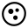
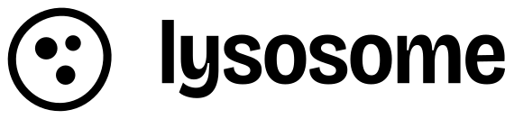
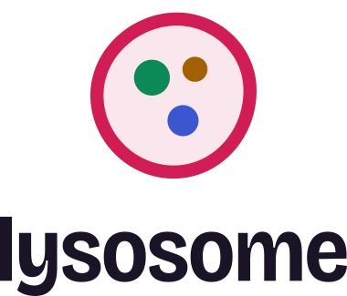
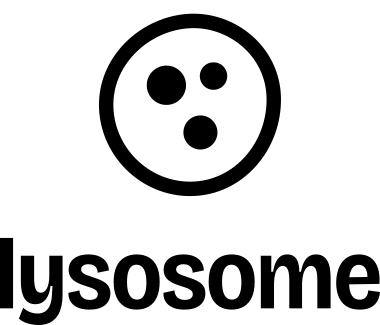
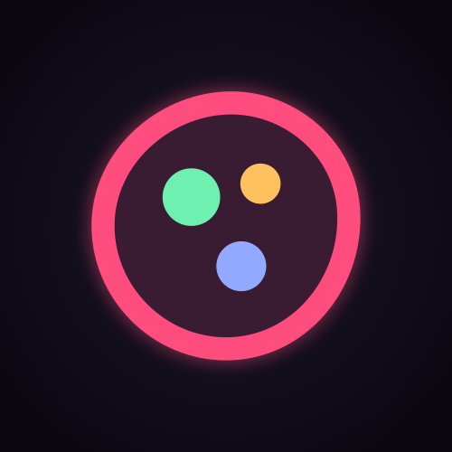
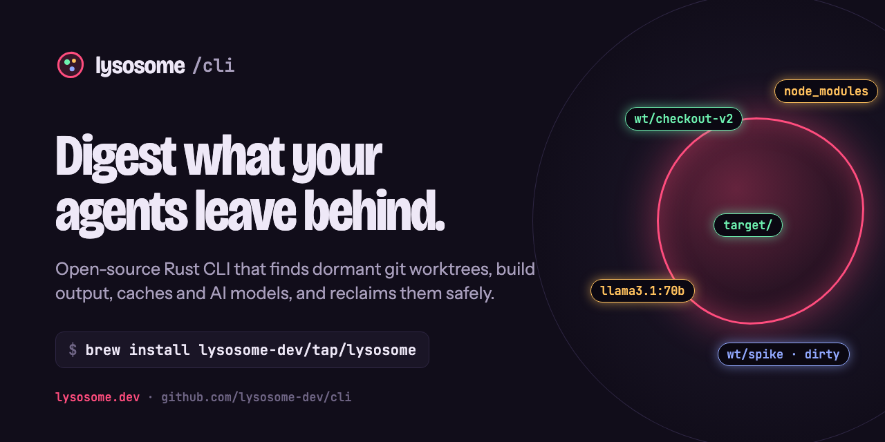
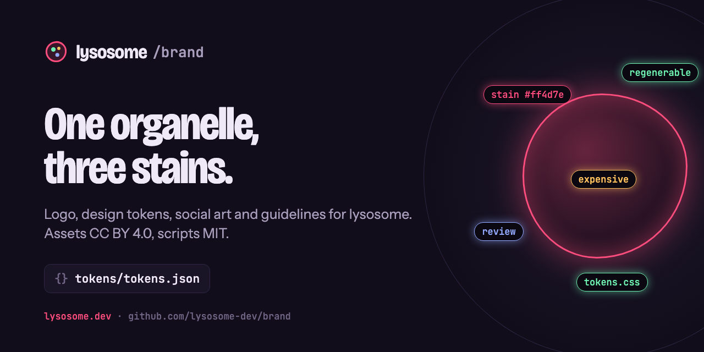
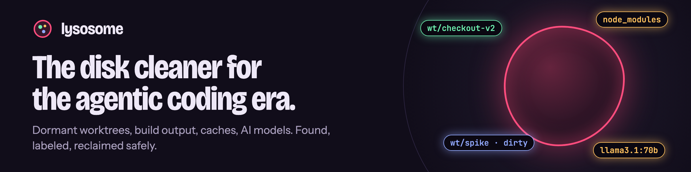
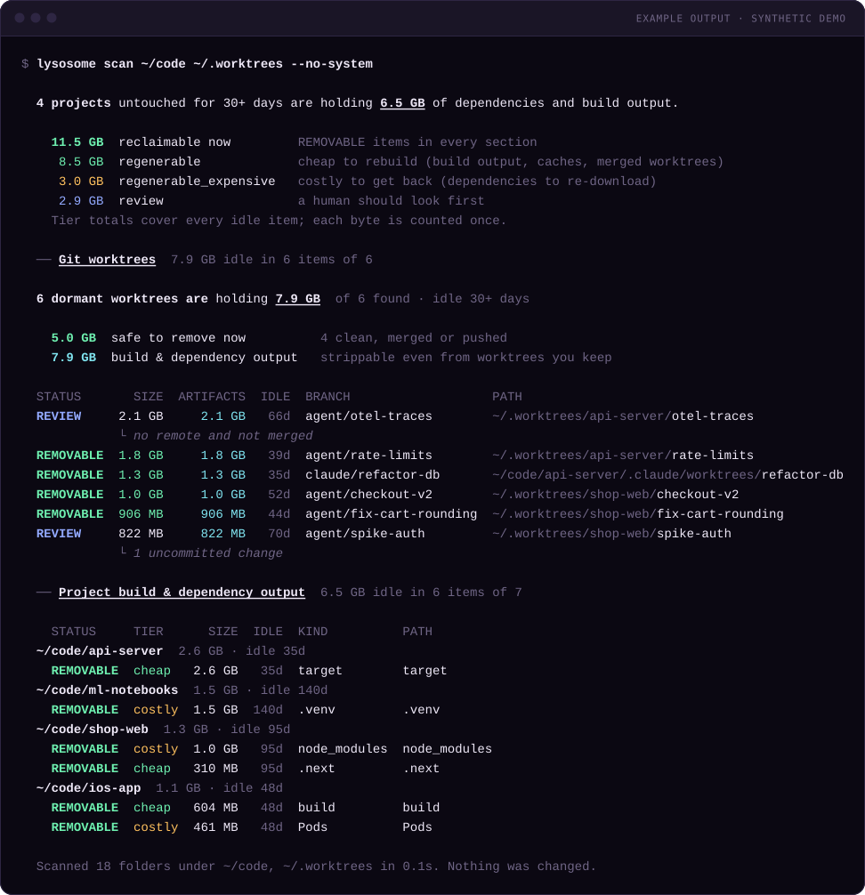

<p align="center">
  <picture>
    <source media="(prefers-color-scheme: dark)" srcset="logo/svg/lockup-horizontal-on-dark.svg">
    
  </picture>
</p>

<p align="center"><b>Brand assets, design tokens and guidelines for <a href="https://lysosome.dev">lysosome</a>,<br>the disk cleaner for the agentic coding era.</b></p>

<p align="center">
  <a href="BRAND.md">Guidelines</a> ·
  <a href="tokens/tokens.json">Tokens</a> ·
  <a href="logo/">Logo</a> ·
  <a href="social/">Social</a> ·
  <a href="terminal/">Terminal art</a> ·
  <a href="https://github.com/lysosome-dev/cli">CLI</a>
</p>

---

A lysosome is the cell's recycling organelle: it breaks down what the cell no longer needs.
The look comes from fluorescence microscopy. The page is a dark slide, the organelle is
stained red, and each safety tier has its own stain. Read [BRAND.md](BRAND.md) before
using anything here.

## Logo

| | On dark | On light | Mono |
|---|---|---|---|
| **Mark** |  |  |  |
| **Horizontal** |  |  |  |
| **Stacked** |  |  |  |
| **Avatar / solid** |  |  | |

The `on-dark` files are drawn for dark backgrounds and `on-light` for light ones, so they
can look washed out in the table on the other GitHub theme. All SVGs use outlined text (no
web fonts). PNGs from 16 to 1024 px are in [`logo/png/`](logo/png/).

## Color

| | Token | Dark | Light | |
|---|---|---|---|---|
|  | `color.stain` | `#ff4d7e` | `#d11d54` | the organelle, primary actions, links |
|  | `color.tier.regenerable` | `#6ef0b0` | `#0b8a57` | cheap to rebuild |
|  | `color.tier.expensive` | `#ffc15e` | `#a35f00` | costly to get back |
|  | `color.tier.review` | `#92a9ff` | `#3a57d1` | a human should look first |
|  | `color.bg` | `#110d1a` | `#f6f3fa` | the slide |
|  | `color.ink` | `#eee8f7` | `#1b1426` | text |

Typefaces: **Bricolage Grotesque** (display, wordmark), **Instrument Sans** (body),
**JetBrains Mono** (commands, paths, numbers), all SIL OFL 1.1 and included in [`fonts/`](fonts/).

## Social

| File | Size | Use |
|---|---|---|
| [`social/repo-cli.png`](social/repo-cli.png) | 1280×640 | GitHub social preview for `cli` |
| [`social/repo-homebrew-tap.png`](social/repo-homebrew-tap.png) | 1280×640 | … for `homebrew-tap` |
| [`social/repo-brand.png`](social/repo-brand.png) | 1280×640 | … for `brand` |
| [`social/repo-generic.png`](social/repo-generic.png) | 1280×640 | any other repo, `.github` |
| [`social/banner-dark.png`](social/banner-dark.png), [`banner-light.png`](social/banner-light.png) | 2400×600 | org profile README banner (`<picture>`) |
| [`social/x-header.png`](social/x-header.png) | 1500×500 | X / Twitter header |
| [`social/og.png`](social/og.png) | 1200×630 | Open Graph link card |

 



## Terminal art

Real `lysosome scan` output, captured from a synthetic demo tree
([`terminal/render.sh`](terminal/render.sh)) and rendered to SVG with the brand terminal theme.



`scan-hero-*.svg` (summary + worktrees, for README headers), `scan-*.svg` (worktrees +
projects), `scan-full-*.svg` (with the suggested cleanup commands), each in dark and light,
plus PNGs at 2×.

## Tokens

[`tokens/tokens.json`](tokens/tokens.json) uses the W3C Design Tokens format; light-theme
values sit in `$extensions["dev.lysosome.modes"].light`. Generate CSS custom properties:

```bash
node scripts/build-tokens.mjs           # writes tokens/tokens.css (no dependencies)
node scripts/build-tokens.mjs --check   # CI: fail if tokens.css is stale
```

```css
@import "tokens/tokens.css";
.button { background: var(--ly-color-stain); color: var(--ly-color-stain-ink); border-radius: var(--ly-radius-pill); }
```

See [BRAND.md → Using the tokens](BRAND.md#using-the-tokens-in-other-repos) for how the
website and READMEs consume them.

## Regenerating

```bash
npm install && npx playwright install chromium     # once, for the PNG renders
pip install fonttools brotli uharfbuzz             # once, for outlining the wordmark
npm run tokens                                     # tokens.css
npm run logo                                       # logo/svg/*.svg + logo/png/*.png (needs rsvg-convert)
terminal/render.sh "$(which lysosome)" "$(mktemp -d)"   # terminal art (macOS)
npm run render                                     # social/*.png, terminal/*.png
```

Sources: `scripts/build_logo.py` (logo geometry and wordmark outlining),
`design/social.html` (all social art, one template, variants by query string),
`scripts/ansi-to-svg.mjs` (terminal renderer).

## License

Assets: [CC BY 4.0](https://creativecommons.org/licenses/by/4.0/). Scripts: MIT. Fonts:
SIL OFL 1.1. "lysosome" and the lysosome logo are trademarks of lysosome.dev; don't use them
to imply endorsement. Details in [LICENSE](LICENSE).
